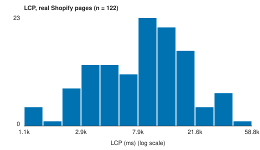
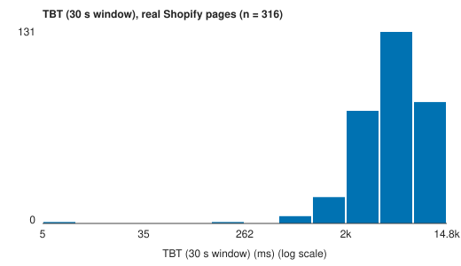

# EDA ban đầu — dataset v0.3.1 (Shopify thật)

> Sinh tự động bởi `node scripts/build-eda-report.js`. Không sửa tay.
> Đơn vị: **1 trang** (store × loại trang) = median các lần đo hợp lệ. 44 store · 74 trang · 309 phép đo hợp lệ.
> Site thuộc **lockbox** (protocol §8) bị loại khỏi EDA. Mọi con số là mô tả, chưa dùng để kết luận hay chọn feature.

## 1. Mẫu theo tầng (reference TBT)

| tầng | store | trang | TBT30 median (ms) | LCP median (ms) |
|---|---|---|---|---|
| light | 16 | 29 | 2895 | 6749 |
| medium | 14 | 23 | 7122 | 9864 |
| heavy | 14 | 22 | 8108 | 9828 |

Kiểm tra hợp lý: nếu phân tầng có ý nghĩa thì TBT30 tăng dần light → heavy.

## 2. Phân phối target (theo loại trang)

### product

| target | n | min | p25 | median | p75 | max |
|---|---|---|---|---|---|---|
| `lh_lcp_ms` | 35 | 1576 | 4292 | 7751 | 10358 | 15413 |
| `tbt_30s_ms` | 35 | 5 | 3193 | 5571 | 8724 | 13463 |
| `lh_tbt_ms` | 32 | 5 | 3201 | 6265 | 9645 | 17951 |
| `lh_fcp_ms` | 35 | 1039 | 2270 | 2791 | 3612 | 10852 |
| `lh_si_ms` | 35 | 2717 | 4846 | 8307 | 11216 | 25466 |
| `lh_cls` | 35 | 0.00 | 0.00 | 0.04 | 0.09 | 0.63 |
| `lh_perf_score` | 32 | 0.05 | 0.29 | 0.34 | 0.44 | 0.92 |

### home

| target | n | min | p25 | median | p75 | max |
|---|---|---|---|---|---|---|
| `lh_lcp_ms` | 39 | 1206 | 6030 | 10344 | 17213 | 58843 |
| `tbt_30s_ms` | 39 | 762 | 3086 | 5245 | 8138 | 11113 |
| `lh_tbt_ms` | 35 | 762 | 3039 | 5828 | 9774 | 16893 |
| `lh_fcp_ms` | 39 | 1059 | 1634 | 2277 | 2971 | 7917 |
| `lh_si_ms` | 39 | 2464 | 5210 | 8882 | 13452 | 28127 |
| `lh_cls` | 39 | 0.00 | 0.00 | 0.05 | 0.11 | 0.39 |
| `lh_perf_score` | 35 | 0.12 | 0.31 | 0.35 | 0.41 | 0.74 |

Thời gian lệch phải mạnh (vài trang rất nặng) → khi huấn luyện cân nhắc biến đổi log của target; quyết định thuộc preprocessing trong inner-CV (protocol §8).

## 3. Phân phối feature (median theo trang)

| feature | bộ | nhóm | n | min | p25 | median | p75 | max |
|---|---|---|---|---|---|---|---|---|
| `request_count` | S | mixed | 74 | 49 | 248 | 366 | 417 | 597 |
| `transfer_bytes_total` | S | mixed | 74 | 838459 | 3661466 | 5334542 | 6599833 | 11734820 |
| `script_requests` | S | main_thread_js | 74 | 23 | 71 | 116 | 147 | 324 |
| `script_bytes` | S | main_thread_js | 74 | 502744 | 1538265 | 2379600 | 3091258 | 4313019 |
| `stylesheet_bytes` | S | render_blocking | 74 | 0 | 58788 | 78951 | 98828 | 214225 |
| `image_bytes` | S | lcp_resource | 74 | 30280 | 432936 | 834536 | 1519256 | 8739567 |
| `font_bytes` | S | render_blocking | 74 | 0 | 79698 | 137686 | 267592 | 705229 |
| `document_bytes` | S | dom_layout | 74 | 43189 | 91378 | 131777 | 192608 | 474250 |
| `third_party_requests` | S | third_party | 74 | 23 | 122 | 184 | 233 | 434 |
| `third_party_bytes` | S | third_party | 74 | 360334 | 1593296 | 2617817 | 3340770 | 9607018 |
| `origin_count` | S | third_party | 74 | 9 | 25 | 39 | 50 | 68 |
| `dom_elements` | S | dom_layout | 74 | 703 | 1682 | 2316 | 3959 | 15008 |
| `lcp_has_resource` | S | lcp_resource | 74 | 0 | 1 | 1 | 1 | 1 |
| `lcp_lazy_loaded` | S | lcp_resource | 74 | 0 | 0 | 0 | 0 | 1 |
| `lcp_not_discoverable` | S | lcp_resource | 74 | 0 | 0 | 0 | 0 | 1 |
| `mt_script_eval_ms` | R | main_thread_js | 74 | 108 | 5567 | 10527 | 16389 | 29500 |
| `mt_script_parse_ms` | R | main_thread_js | 74 | 4 | 504 | 872 | 1086 | 2369 |
| `mt_gc_ms` | R | main_thread_js | 74 | 0 | 132 | 218 | 275 | 431 |
| `mt_style_layout_ms` | R | dom_layout | 74 | 420 | 1571 | 2848 | 5742 | 19297 |
| `mt_rendering_ms` | R | dom_layout | 74 | 123 | 626 | 1196 | 2598 | 7509 |
| `mt_parse_html_ms` | R | mixed | 74 | 89 | 213 | 331 | 459 | 1319 |
| `render_blocking_count` | R | render_blocking | 74 | 0 | 0 | 3 | 9 | 30 |
| `bootup_js_ms` | R | main_thread_js | 74 | 73 | 5839 | 11142 | 17291 | 30094 |
| `third_party_main_thread_ms` | R | third_party | 67 | 58 | 3949 | 7299 | 12609 | 29809 |
| `unused_js_bytes` | R | main_thread_js | 74 | 0 | 136409 | 260606 | 576672 | 971668 |
| `unused_css_bytes` | R | render_blocking | 74 | 0 | 0 | 11240 | 26502 | 72972 |
| `server_response_time_ms` | R | server | 74 | 28 | 32 | 34 | 180 | 2037 |
| `trace_long_task_count` | R | main_thread_js | 74 | 4 | 35 | 49 | 66 | 91 |
| `trace_long_task_total_ms` | R | main_thread_js | 74 | 373 | 5389 | 8243 | 12279 | 17307 |
| `trace_long_task_max_ms` | R | main_thread_js | 74 | 169 | 647 | 828 | 1120 | 4801 |

## 4. Tương quan Spearman feature ↔ target

| feature | bộ | ρ với LCP | ρ với TBT30 | ghi chú |
|---|---|---|---|---|
| `trace_long_task_total_ms` | R | 0.26 | 0.98 | loại khi target = TBT (L5) |
| `bootup_js_ms` | R | 0.30 | 0.81 |  |
| `mt_script_eval_ms` | R | 0.30 | 0.80 |  |
| `trace_long_task_count` | R | 0.30 | 0.79 | loại khi target = TBT (L5) |
| `third_party_main_thread_ms` | R | 0.36 | 0.78 |  |
| `trace_long_task_max_ms` | R | 0.15 | 0.78 | loại khi target = TBT (L5) |
| `mt_parse_html_ms` | R | 0.24 | 0.68 |  |
| `mt_script_parse_ms` | R | 0.27 | 0.66 |  |
| `script_bytes` | S | 0.25 | 0.62 |  |
| `unused_js_bytes` | R | 0.04 | 0.61 |  |
| `origin_count` | S | 0.26 | 0.60 |  |
| `request_count` | S | 0.16 | 0.59 |  |
| `mt_style_layout_ms` | R | 0.11 | 0.58 |  |
| `third_party_requests` | S | 0.18 | 0.57 |  |
| `third_party_bytes` | S | 0.33 | 0.53 |  |
| `mt_gc_ms` | R | 0.24 | 0.50 |  |
| `document_bytes` | S | 0.27 | 0.49 |  |
| `script_requests` | S | 0.19 | 0.48 |  |
| `image_bytes` | S | 0.47 | 0.23 |  |
| `dom_elements` | S | 0.27 | 0.46 |  |
| `transfer_bytes_total` | S | 0.39 | 0.46 |  |
| `lcp_has_resource` | S | 0.43 | 0.12 |  |
| `mt_rendering_ms` | R | 0.22 | 0.41 |  |
| `lcp_lazy_loaded` | S | 0.36 | 0.07 |  |
| `font_bytes` | S | 0.18 | 0.34 |  |
| `stylesheet_bytes` | S | -0.12 | 0.30 |  |
| `lcp_not_discoverable` | S | 0.26 | -0.03 |  |
| `unused_css_bytes` | R | -0.11 | 0.25 |  |
| `server_response_time_ms` | R | -0.23 | -0.17 |  |
| `render_blocking_count` | R | 0.21 | 0.13 |  |

Cặp feature tương quan rất cao (|ρ| > 0,9) chia sẻ đóng góp SHAP tùy ý → lý do gộp SHAP theo cause group (protocol §8).

## 5. Tóm tắt theo store

| store | tầng | trang | runs ok | LCP | TBT30 | requests | KB tải | 3rd-party req | DOM |
|---|---|---|---|---|---|---|---|---|---|
| adresmedikal.net | light | home | 4 | 2979 | 2724 | 198 | 2715 | 101 | 954 |
| adresmedikal.net | light | product | 5 | 4198 | 2479 | 219 | 2837 | 120 | 765 |
| ajantashoes.com | medium | home | 1 | 1206 | 5245 | 217 | 11067 | 79 | 1121 |
| amixstore.com | medium | home | 5 | 2845 | 4300 | 464 | 7143 | 270 | 2787 |
| amixstore.com | medium | product | 5 | 4182 | 6304 | 466 | 5533 | 283 | 2299 |
| candyfunhouse.ca | heavy | product | 1 | 7751 | 9319 | 452 | 5563 | 296 | 1707 |
| iyaksticker.in | light | product | 1 | 8677 | 2383 | 318 | 2353 | 131 | 703 |
| kabegamiyahonpo.com | heavy | home | 5 | 11350 | 4017 | 303 | 10316 | 134 | 3675 |
| kabegamiyahonpo.com | heavy | product | 5 | 13589 | 2887 | 343 | 6978 | 174 | 2387 |
| leathergallery.co.za | medium | home | 2 | 11002 | 3880 | 293 | 6358 | 121 | 2364 |
| lukmed.cl | light | home | 5 | 2928 | 4184 | 181 | 5469 | 59 | 1473 |
| lukmed.cl | light | product | 5 | 3657 | 3447 | 160 | 2562 | 65 | 976 |
| miraggiolife.com | heavy | home | 5 | 58843 | 8142 | 432 | 10433 | 224 | 5529 |
| miraggiolife.com | heavy | product | 4 | 3674 | 9619 | 530 | 5659 | 256 | 3246 |
| mssaz.com | light | home | 5 | 4497 | 4810 | 332 | 2533 | 138 | 4522 |
| mssaz.com | light | product | 5 | 8524 | 7149 | 366 | 3691 | 154 | 3858 |
| par2.pa | medium | home | 5 | 10344 | 3841 | 201 | 4463 | 96 | 1018 |
| par2.pa | medium | product | 5 | 5239 | 4829 | 227 | 4348 | 131 | 1182 |
| pepco.ro | light | home | 5 | 10267 | 1841 | 116 | 2958 | 111 | 1882 |
| pepco.ro | light | product | 5 | 8816 | 1542 | 99 | 2129 | 94 | 739 |
| pepperfield.cz | medium | home | 1 | 16220 | 8816 | 389 | 10568 | 222 | 5317 |
| petiscope.fr | light | home | 1 | 6749 | 2540 | 386 | 4672 | 206 | 1418 |
| petiscope.fr | light | product | 2 | 10852 | 2503 | 426 | 5088 | 230 | 1869 |
| pgservice.cc | light | home | 5 | 5312 | 2488 | 367 | 2420 | 174 | 6648 |
| pgservice.cc | light | product | 5 | 4147 | 2057 | 397 | 2330 | 222 | 6652 |
| rdstudio.co | medium | home | 5 | 10418 | 9901 | 401 | 4671 | 267 | 2646 |
| rdstudio.co | medium | product | 5 | 11554 | 10765 | 409 | 4430 | 303 | 2247 |
| shop.comofootball.com | light | home | 1 | 2923 | 5297 | 445 | 6184 | 155 | 3233 |
| shopusa.season-of-mist.com | light | home | 5 | 31786 | 2577 | 265 | 5838 | 129 | 1204 |
| shopusa.season-of-mist.com | light | product | 5 | 4385 | 3224 | 384 | 3685 | 200 | 1373 |
| simorra.com | heavy | product | 1 | 3314 | 9479 | 377 | 5208 | 222 | 1993 |
| stealplug.com.my | heavy | home | 5 | 19325 | 7672 | 221 | 5115 | 110 | 6313 |
| stealplug.com.my | heavy | product | 5 | 5974 | 5571 | 265 | 3402 | 137 | 1964 |
| stevemadden.co.za | heavy | home | 5 | 10016 | 4578 | 371 | 6291 | 215 | 3471 |
| stevemadden.co.za | heavy | product | 4 | 5132 | 6400 | 375 | 5029 | 201 | 1872 |
| vegane-fleischerei.de | medium | home | 5 | 30396 | 4345 | 352 | 6969 | 161 | 3073 |
| vegane-fleischerei.de | medium | product | 5 | 13200 | 3408 | 435 | 6887 | 227 | 2489 |
| verysmart.ca | heavy | home | 5 | 8562 | 8223 | 287 | 3539 | 226 | 5343 |
| verysmart.ca | heavy | product | 5 | 14752 | 3162 | 382 | 4594 | 244 | 2272 |
| vimergy.com | heavy | home | 5 | 25121 | 8134 | 365 | 9875 | 251 | 2779 |
| vimergy.com | heavy | product | 5 | 9641 | 8082 | 441 | 5279 | 334 | 3774 |
| wearme.ua | heavy | home | 5 | 8512 | 7785 | 472 | 9822 | 194 | 15008 |
| www.ayntec.com | light | home | 5 | 7554 | 1917 | 141 | 1940 | 55 | 2065 |
| www.ayntec.com | light | product | 5 | 13021 | 2895 | 188 | 1979 | 82 | 2251 |
| www.bajaao.com | heavy | home | 5 | 15418 | 9811 | 398 | 6796 | 237 | 4673 |
| www.bajaao.com | heavy | product | 5 | 1576 | 9360 | 452 | 6474 | 302 | 2326 |
| www.campusshoes.com | light | home | 5 | 2858 | 762 | 67 | 890 | 25 | 4683 |
| www.campusshoes.com | light | product | 5 | 2729 | 5 | 49 | 819 | 23 | 1025 |
| www.cherrykitten.com | medium | home | 5 | 18206 | 8911 | 398 | 5913 | 213 | 5523 |
| www.cherrykitten.com | medium | product | 5 | 9851 | 8852 | 451 | 6035 | 281 | 4061 |
| www.diabolique.es | heavy | home | 1 | 13285 | 3094 | 239 | 4063 | 137 | 2213 |
| www.eden-park.com | light | product | 1 | 15276 | 4911 | 331 | 11460 | 173 | 3913 |
| www.joone.fr | medium | home | 5 | 21999 | 3078 | 287 | 9554 | 192 | 1313 |
| www.joone.fr | medium | product | 5 | 5519 | 6775 | 317 | 5163 | 197 | 1200 |
| www.livreeleve.com.br | medium | home | 5 | 12818 | 7122 | 417 | 11073 | 126 | 2744 |
| www.livreeleve.com.br | medium | product | 5 | 7578 | 7395 | 387 | 9508 | 169 | 2011 |
| www.musikalcol.store | light | home | 5 | 3202 | 2990 | 199 | 2729 | 85 | 1674 |
| www.musikalcol.store | light | product | 5 | 6283 | 4072 | 209 | 2644 | 94 | 1030 |
| www.myfonts.com | medium | home | 1 | 14319 | 6931 | 346 | 7410 | 202 | 1787 |
| www.natori.com | medium | home | 5 | 9665 | 7702 | 417 | 6156 | 234 | 4982 |
| www.natori.com | medium | product | 5 | 9864 | 8596 | 547 | 8293 | 352 | 5422 |
| www.newera.mx | heavy | home | 5 | 14879 | 10345 | 382 | 5993 | 202 | 5038 |
| www.newera.mx | heavy | product | 5 | 7789 | 12879 | 490 | 5546 | 330 | 4598 |
| www.orionride.com | medium | home | 1 | 9193 | 7722 | 333 | 4284 | 175 | 1539 |
| www.pichara.cl | light | home | 5 | 19023 | 9048 | 295 | 4724 | 102 | 3974 |
| www.pichara.cl | light | product | 5 | 15413 | 13463 | 309 | 4098 | 136 | 1819 |
| www.pinko.com | medium | home | 5 | 9522 | 8674 | 383 | 5773 | 211 | 2291 |
| www.pinko.com | medium | product | 5 | 6523 | 11840 | 457 | 6198 | 252 | 4881 |
| www.puropelle.com | light | home | 5 | 3060 | 2389 | 202 | 2331 | 85 | 1170 |
| www.puropelle.com | light | product | 5 | 8908 | 4317 | 242 | 2769 | 110 | 2378 |
| www.quadlockcase.eu | light | home | 5 | 27611 | 5493 | 576 | 10170 | 412 | 1884 |
| www.quadlockcase.eu | light | product | 5 | 13649 | 5072 | 597 | 4941 | 434 | 2306 |
| www.redapplefireworks.com | heavy | product | 1 | 2270 | 8035 | 356 | 5818 | 253 | 3311 |
| www.revesderecho.com | heavy | home | 1 | 20879 | 11113 | 438 | 5211 | 151 | 4418 |

## 6. Tóm tắt theo điều kiện (testbed)

Xem `docs/fault-matrix-noise-report.md` (median [IQR] theo fault × mức × trang, manipulation check, dose–response).

