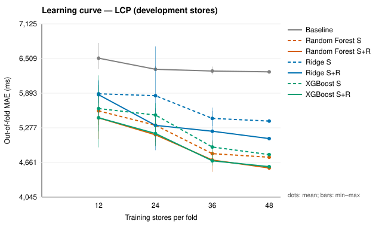
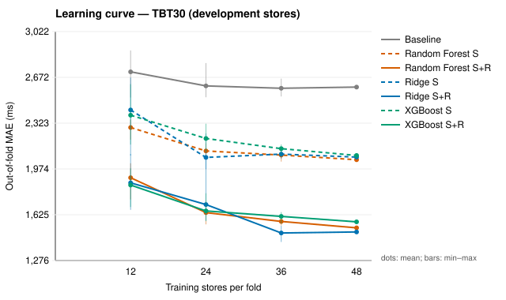

# Learning curve — RQ1/RQ2 (development stores)

> Sinh tự động bởi `scripts/build_learning_curve.py`. Không sửa tay.
> Run `learning-curve-261021-v0.4` · dataset sha256 `3163db4de4fece62…` · seed 42 · 60 store dev. **Lockbox không được dùng.**
> Mỗi điểm = MAE out-of-fold gộp trên toàn bộ 570 dòng dev; fold test giữ nguyên, chỉ huấn luyện trên n store ngẫu nhiên của fold train; cùng pipeline và lưới tuning như run chính. Mỗi mức n nhỏ lặp 5 lần bốc ngẫu nhiên.

## LCP

| mô hình | bộ | n = 12 (~12 store) | n = 24 (~24 store) | n = 36 (~36 store) | n = all (~48 store) | Δ% từ mức áp chót → toàn bộ |
|---|---|---|---|---|---|---|
| Baseline | - | 6,515 [6,321–6,786] | 6,318 [6,290–6,382] | 6,287 [6,228–6,366] | 6,273 [6,273–6,273] | -0.2% |
| Ridge | S | 5,883 [5,472–6,129] | 5,849 [5,416–6,726] | 5,445 [5,310–5,637] | 5,398 [5,398–5,398] | -0.9% |
| Random Forest | S | 5,579 [5,330–5,856] | 5,324 [5,023–5,605] | 4,818 [4,678–5,036] | 4,755 [4,755–4,755] | -1.3% |
| XGBoost | S | 5,621 [5,216–6,210] | 5,505 [5,177–5,715] | 4,937 [4,718–5,058] | 4,802 [4,802–4,802] | -2.7% |
| Ridge | S+R | 5,865 [5,715–6,105] | 5,321 [4,881–5,630] | 5,216 [4,915–5,575] | 5,086 [5,086–5,086] | -2.5% |
| Random Forest | S+R | 5,455 [5,079–5,643] | 5,153 [4,961–5,434] | 4,705 [4,495–4,855] | 4,563 [4,563–4,563] | -3.0% |
| XGBoost | S+R | 5,457 [4,930–6,038] | 5,177 [4,949–5,501] | 4,691 [4,607–4,815] | 4,587 [4,587–4,587] | -2.2% |

## TBT30

| mô hình | bộ | n = 12 (~12 store) | n = 24 (~24 store) | n = 36 (~36 store) | n = all (~48 store) | Δ% từ mức áp chót → toàn bộ |
|---|---|---|---|---|---|---|
| Baseline | - | 2,715 [2,519–2,878] | 2,607 [2,521–2,781] | 2,589 [2,527–2,663] | 2,599 [2,599–2,599] | +0.4% |
| Ridge | S | 2,424 [2,076–2,671] | 2,062 [1,972–2,245] | 2,087 [2,052–2,127] | 2,065 [2,065–2,065] | -1.1% |
| Random Forest | S | 2,290 [2,197–2,349] | 2,111 [2,069–2,169] | 2,080 [2,030–2,120] | 2,045 [2,045–2,045] | -1.7% |
| XGBoost | S | 2,384 [2,160–2,621] | 2,207 [2,105–2,319] | 2,129 [2,071–2,161] | 2,077 [2,077–2,077] | -2.5% |
| Ridge | S+R | 1,868 [1,662–2,088] | 1,702 [1,580–2,070] | 1,486 [1,418–1,541] | 1,494 [1,494–1,494] | +0.5% |
| Random Forest | S+R | 1,907 [1,741–2,017] | 1,641 [1,551–1,731] | 1,574 [1,543–1,605] | 1,525 [1,525–1,525] | -3.1% |
| XGBoost | S+R | 1,851 [1,684–1,979] | 1,654 [1,576–1,789] | 1,612 [1,556–1,645] | 1,571 [1,571–1,571] | -2.6% |

## Cách đọc

- Ô bảng: MAE trung bình (ms) qua các lần bốc [min–max].
- Cột cuối: thay đổi MAE khi tăng từ mức n áp chót lên toàn bộ store train. Càng gần 0 thì đường cong càng phẳng (dữ liệu gần bão hòa); giảm rõ (ví dụ < −5%) nghĩa là thêm store có thể còn giúp.
- Chỉ đo được tới khoảng 46–52 store train mỗi fold, nên không ngoại suy chính xác cho cỡ mẫu lớn hơn.
